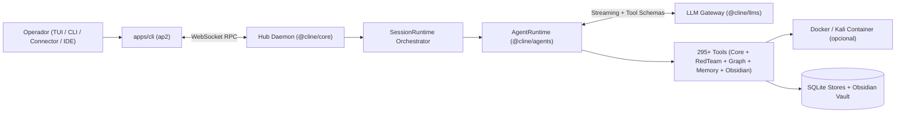

# AP2 — Autonomous Offensive Security & Full-Scale Engineering Agent

**AP2** é uma plataforma autônoma de **engenharia de segurança ofensiva (Red Team) e desenvolvimento de software em larga escala**, construída sobre a arquitetura monorepo do **Cline SDK** (`Bun 1.4.2` + `Node.js >= 22`).

O sistema combina **mais de 295 ferramentas especializadas** (reconhecimento, análise de vulnerabilidades, exploração, pós-exploração, Active Directory, C2/OOB, engenharia reversa, memória cognitiva, grafo duplo de cobertura e base de conhecimento Obsidian) com um **runtime resiliente de execução contínua**, geração de código completo sem truncamentos/stubs, times multi-agentes, execução isolada em contêiner **Docker/Kali Linux**, conectores de chat e agendamentos automatizados.

---

## Sumário

- [Principais Recursos](#principais-recursos)
- [Arquitetura do Monorepo](#arquitetura-do-monorepo)
- [Subsistemas Especializados e Ferramentas](#subsistemas-especializados-e-ferramentas)
- [Requisitos](#requisitos)
- [Instalação e Build](#instalação-e-build)
- [Configuração de Provedores e Credenciais (Segurança)](#configuração-de-provedores-e-credenciais-segurança)
- [Modos de Uso da CLI (`ap2`)](#modos-de-uso-da-cli-ap2)
- [Integração Docker / Kali Linux](#integração-docker--kali-linux)
- [Base de Conhecimento Obsidian](#base-de-conhecimento-obsidian)
- [Times de Agentes, Conectores e Agendamentos](#times-de-agentes-conectores-e-agendamentos)
- [Desenvolvimento, Qualidade e Testes](#desenvolvimento-qualidade-e-testes)
- [Segurança Operacional e Governança](#segurança-operacional-e-governança)
- [Licença](#licença)

---

## Principais Recursos

- **234 Ferramentas Red Team (`rt_*`)**: Cobertura ponta a ponta da kill chain — enumeração passiva/ativa, descoberta de ativos, scanning de portas/serviços, fuzzing, validação de CVEs, exploração web/rede/AD/cloud, pós-exploração, stealth/evasão, OOB/listeners, campanhas autônomas e engenharia reversa.
- **Grafo Duplo de Cobertura (`Dual-Graph`)**: Rastreamento estruturado de superfície de ataque (*Asset Graph*) e caminhos/hipóteses de exploração (*Exploration Graph* + *Execution Traces*) em SQLite.
- **Arquitetura Cognitiva & Memória Persistente**: Memória episódica/semântica em SQLite (`memory_*`), pilha de metas e crenças (`goal_*`, `belief_add`, `reflect`, `introspect`) e motor cognitivo (`cg_*`) com telemetria de comandos, links associativos e predições.
- **Integração Nativa com Obsidian (`obs_*`)**: Persistência automática de relatórios técnicos (`knowledge/reports/`), notas diárias, memórias de longo prazo e adaptação orgânica de estilo de comunicação.
- **Geração de Código Full-Scale (Zero Stubs)**: Políticas de prompt e guardas em tempo de execução que impedem código incompleto/resumido, com suporte a escrita contínua via `editor` (`append: true`), limite de argumentos expandido (`500.000` caracteres) e teto padrão de saída de `64.000` tokens no gateway LLM.
- **Runtime Anti-Travamento & Auto-Recuperação**:
  - Detecção de parada prematura e de chamadas de ferramentas vazadas em XML/texto bruto (`<tool_call>`), forçando reexecução estruturada.
  - Recuperação automática em cortes por `max-tokens`, compactação automática em estouro de janela de contexto e retry exponencial para erros transitórios de provedores.
  - Proteção inteligente contra loops (`LoopDetectionTracker` + `MistakeTracker`) com avisos injetados antes do modelo (`beforeModel`), bloqueio preventivo de chamadas duplicadas (`beforeTool`) e isolamento entre turnos.
- **Hub Daemon Compartilhado (`@cline/cline-hub`)**: Daemon local via WebSocket (`127.0.0.1:25463`) gerenciado automaticamente pela CLI para sessões persistentes, execução em background (`--zen`), reconexão de conectores e coordenação multi-cliente.
- **Multi-Provedor LLM (`@cline/llms`)**: Suporte nativo a NVIDIA NIM, Anthropic, OpenAI / ChatGPT Codex, Google Gemini, OpenRouter, AWS Bedrock, GCP Vertex AI, Mistral, Ollama e qualquer endpoint compatível com OpenAI.

---

## Arquitetura do Monorepo

```text
AP2/
├── apps/
│   ├── cli/                    # CLI interativa (OpenTUI) + headless (binário `ap2`)
│   ├── cline-hub/              # Daemon de sessões, RPC WebSocket e webview de gestão
│   ├── vscode/                 # Extensão VS Code integrada ao core
│   └── examples/
│       └── desktop-app/        # App Desktop nativo (Tauri v2 + Next.js + Bun sidecar)
├── sdk/
│   ├── packages/
│   │   ├── shared/             # Tipos, contratos, schemas, prompts de sistema e utilitários SQLite
│   │   ├── llms/               # Gateway unificado de provedores LLM, catálogos e reparo de tool-calls
│   │   ├── agents/             # Loop de execução `AgentRuntime`, hooks, retries e recuperação de contexto
│   │   ├── core/               # Orquestrador de sessão, ferramentas nativas, Red Team, Cognição, Grafo, Memória e Obsidian
│   │   ├── sdk/                # Superfície pública programática (`@cline/sdk`)
│   │   └── ui/                 # Sistema de temas e componentes compartilhados
│   └── scripts/                # Automação de build, limpeza, verificação e release
└── docs/                       # Documentação complementar de provedores, SDK e recursos
```

### Fluxo de Execução



---

## Subsistemas Especializados e Ferramentas

Além das ferramentas fundamentais de engenharia (`read_files`, `editor`, `apply_patch`, `search_codebase`, `run_commands`, `fetch_web_content`, `skills`, `ask_question`, `spawn_agent`, `team_*`), o pacote `sdk/packages/core` disponibiliza:

| Módulo | Caminho | Qtd. | Exemplos de Ferramentas |
| :--- | :--- | :---: | :--- |
| **Red Team & OffSec** | `sdk/packages/core/src/redteam/` | **234** | `rt_nmap`, `rt_nuclei`, `rt_subfinder`, `rt_httpx`, `rt_sqlmap`, `rt_ffuf`, `rt_impacket`, `rt_netexec`, `rt_certipy`, `rt_plan_auto`, `rt_campaign_*`, `rt_supervisor_*`, `rt_docker_*`, `rt_stealth_*`, `rt_reverse_engineer`, `rt_cred_store`, `rt_audit_persist` |
| **Obsidian Sync & Voice** | `sdk/packages/core/src/obsidian/` | **19** | `obs_save_report`, `obs_write_note`, `obs_read_note`, `obs_search`, `obs_remember`, `obs_recall`, `obs_save_knowledge`, `obs_daily_note`, `obs_set_personality`, `obs_update_user_style` |
| **Cognitive Engine** | `sdk/packages/core/src/cognitive/` | **18** | `cg_profile_get`, `cg_command_log`, `cg_command_stats`, `cg_emotion_set`, `cg_memory_link`, `cg_predict`, `cg_reflect`, `cg_think`, `cg_filter` |
| **Dual-Graph Coverage** | `sdk/packages/core/src/graph/` | **12** | `rt_asset_add`, `rt_asset_list`, `rt_asset_tested`, `rt_coverage`, `rt_explore_add`, `rt_explore_update`, `rt_anchor`, `rt_trace_log`, `rt_trace_search` |
| **Memory & Self-State** | `sdk/packages/core/src/memory/` | **12** | `memory_store`, `memory_recall`, `memory_forget`, `memory_list`, `goal_push`, `goal_complete`, `belief_add`, `open_question`, `reflect`, `introspect` |

### Subagentes Especializados
Para execução paralela e divisão tática de trabalho via `spawn_agent` / `team_*`:
- `subagent_recon` — Reconhecimento e mapeamento de superfície
- `subagent_pesquisa` — Pesquisa técnica de CVEs, documentação e código
- `subagent_exploit` — Desenvolvimento e validação de PoCs
- `subagent_forense` — Análise de artefatos, logs e memória
- `subagent_defesa` — Hardening, detecção e remediação
- `subagent_compactador` — Síntese densa de contexto operacional

---

## Requisitos

- **Bun** `1.4.2` (gerenciador de pacotes e executor de builds do monorepo — **não utilize** `npm`, `yarn` ou `pnpm` para instalar dependências do workspace)
- **Node.js** `>= 22`
- **Git**
- **Docker Desktop / Docker Engine** *(opcional — necessário apenas para execução isolada em contêiner Kali Linux via `rt_docker_*`)*
- **Credencial de um provedor LLM** (chave de API ou autenticação OAuth configurada localmente)

---

## Instalação e Build

```bash
# 1. Clonar o repositório
git clone https://github.com/sallutfederal/AP2.git
cd AP2

# 2. Instalar dependências com Bun
bun install

# 3. Compilar todos os pacotes do SDK (@cline/shared, ui, llms, agents, core, sdk)
bun run build:sdk

# 4. Compilar a CLI (@cline/cli -> comando `ap2`)
bun -F @cline/cli build
```

> **Importante:** Os pacotes internos do SDK resolvem entre si através dos artefatos compilados em `dist/`. Sempre que alterar código em `sdk/packages/*`, execute `bun run build:sdk` (e reinicie o daemon com `bun run cli hub stop` se estiver ativo) antes de testar na CLI.

### Registrar o comando global `ap2` no terminal (opcional)

```bash
cd apps/cli
bun link
```

Após o link, basta digitar `ap2` em qualquer diretório do sistema. Também é possível rodar diretamente a partir da raiz do projeto com `bun run cli`.

---

## Configuração de Provedores e Credenciais (Segurança)

> **Nunca salve chaves de API, tokens OAuth, arquivos `.env` ou segredos dentro do repositório Git.** Todas as credenciais devem ficar apenas em variáveis de ambiente da sua máquina ou no diretório local do usuário (`~/.cline/data/`), que fica fora do controle de versão.

### Opção 1: Assistente interativo de autenticação

```bash
ap2 auth
```

Ou configurando diretamente um provedor via linha de comando:

```bash
# Exemplo com Anthropic
ap2 auth --provider anthropic --apikey "$ANTHROPIC_API_KEY" --modelid claude-sonnet-4-6

# Exemplo com OpenRouter
ap2 auth --provider openrouter --apikey "$OPENROUTER_API_KEY" --modelid anthropic/claude-sonnet-4.6

# Exemplo com endpoint compatível com OpenAI / NVIDIA NIM
ap2 auth --provider nvidia --apikey "$NVIDIA_API_KEY" --modelid poolside/laguna-xs-2.1
```

### Opção 2: Variáveis de ambiente

Defina no perfil do seu shell (`~/.bashrc`, `~/.zshrc` ou variáveis de usuário do Windows PowerShell):

```powershell
# PowerShell (Windows)
$env:NVIDIA_API_KEY = "sua-chave-aqui"
$env:OPENROUTER_API_KEY = "sua-chave-aqui"
$env:ANTHROPIC_API_KEY = "sua-chave-aqui"
$env:OPENAI_API_KEY = "sua-chave-aqui"

# Caminho opcional do Vault do Obsidian (padrão: ~/Documents/Obsidian Vault)
$env:OBSIDIAN_VAULT_PATH = "$HOME\Documents\Obsidian Vault"

# Segredo opcional para derivação da chave AES-256-GCM do cofre Red Team
$env:CLINE_CRED_VAULT_SECRET = "segredo-local-forte"
```

---

## Modos de Uso da CLI (`ap2`)

```bash
# Modo interativo completo (TUI com streaming, diffs, aprovações e slash commands)
ap2

# Modo interativo já iniciando com um objetivo
ap2 -i "Analise a arquitetura deste projeto e implemente os módulos faltantes"

# Execução direta (one-shot)
ap2 "Audite este serviço em busca de falhas de autenticação e proponha correções"

# Modo Yolo (aprovação automática de ferramentas para automação/execução contínua)
ap2 --yolo "Execute os testes unitários e corrija eventuais regressões"

# Modo JSON (streaming de eventos NDJSON para integração em pipelines)
ap2 --json "Liste os endpoints expostos na aplicação"

# Modo Zen (despacha a tarefa em background para o Hub Daemon e retorna imediatamente)
ap2 --zen "Gere uma revisão completa da suíte de testes"
```

### Gerenciamento do Hub Daemon e Diagnóstico

```bash
# Verificar saúde do ambiente local
ap2 doctor

# Parar o Hub Daemon em execução (útil após recompilar o SDK)
ap2 hub stop

# Exibir versão
ap2 version
```

---

## Integração Docker / Kali Linux

Para executar ferramentas ofensivas reais (`nmap`, `nuclei`, `sqlmap`, `ffuf`, `gobuster`, `nikto`, `masscan`, `hydra`, `wafw00f`, `whatweb`, `impacket`, etc.) de forma isolada dentro de um contêiner Kali Linux:

```text
# Dentro do chat interativo do AP2:
rt_docker_setup
rt_docker_enable enabled=true
rt_docker_status
```

Exemplos de fluxos assistidos pelas ferramentas `rt_*` (exclusivamente em ambientes e escopos formalmente autorizados):

```text
# Definir e validar escopo autorizado antes da operação
rt_scope_set targets=["lab.internal.example"]
rt_scope_enforce enabled=true

# Planejamento autônomo estruturado
rt_plan_auto goal="Avaliar superfície web do ambiente de homologação" target="lab.internal.example" mode="recon"

# Auditoria verificável (cadeia SHA-256)
rt_audit_tail limit=20
```

---

## Base de Conhecimento Obsidian

O AP2 integra-se nativamente a um Vault do Obsidian para manter memória contínua entre sessões:

- **Local padrão do Vault:** `~/Documents/Obsidian Vault` (personalizável via variável de ambiente `OBSIDIAN_VAULT_PATH`).
- **Estrutura gerenciada automaticamente:**
  - `knowledge/reports/` — Relatórios técnicos de tarefas e operações (`obs_save_report`)
  - `knowledge/` — Notas técnicas reutilizáveis (`obs_save_knowledge`)
  - `memory/` — Fatos e preferências persistentes (`obs_remember` / `obs_recall`)
  - `daily/` e `sessions/` — Diário operacional e histórico resumido de sessões
  - `personality.md` e `user-style.md` — Voz do agente e adaptação automática ao estilo do operador

---

## Times de Agentes, Conectores e Agendamentos

### Conectores de Mensageria
Conecte canais externos diretamente a sessões persistentes do Hub Daemon (use variáveis de ambiente para nunca expor tokens no histórico do terminal):

```bash
# Telegram
ap2 connect telegram -k "$TELEGRAM_BOT_TOKEN"

# Slack (Socket Mode)
ap2 connect slack --bot-token "$SLACK_BOT_TOKEN" --app-token "$SLACK_APP_TOKEN"

# Encerrar conectores ativos
ap2 connect --stop
```

### Agendamentos (`schedule`)

```bash
ap2 schedule create "Revisão diária de segurança" \
  --cron "0 9 * * MON-FRI" \
  --prompt "Verifique novas dependências e valide testes críticos." \
  --workspace /caminho/do/projeto

ap2 schedule list
```

---

## Desenvolvimento, Qualidade e Testes

```bash
# Build completo do SDK + CLI
bun run build:sdk
bun -F @cline/cli build

# Verificação de tipos em todo o workspace
bun run types

# Formatação e lint com Biome
bun run format
bun run lint

# Testes unitários por pacote
bun -F @cline/agents test
bun -F @cline/llms test
bun -F @cline/core test:unit
bun -F @cline/cli test:unit

# Extensão VS Code (apps/vscode)
cd apps/vscode
bun run build:webview
bun esbuild.mjs

# Aplicativo Desktop (apps/examples/desktop-app)
cd apps/examples/desktop-app
bun run dev
```

---

## Segurança Operacional e Governança

1. **Uso Exclusivo Autorizado:** Todas as ferramentas de segurança ofensiva (`rt_*`) destinam-se estritamente a testes de intrusão contratados, laboratórios próprios, CTFs, Cyber Ranges e auditorias com autorização formal documentada. Utilize sempre `rt_scope_set`, `rt_scope_enforce`, `rt_dry_run` e `rt_kill_switch`.
2. **Proteção de Segredos e Dados locais:**
   - Bancos SQLite locais (`~/.cline/data/db/*.db`), sessões (`~/.cline/data/sessions/`), configurações de provedores (`providers.json`), arquivos `.env*`, certificados/chaves privadas (`*.pem`, `*.key`, `*.pfx`) e relatórios locais são ignorados via `.gitignore`.
   - Credenciais operacionais salvas pelo `rt_cred_store` são cifradas em repouso com **AES-256-GCM**.
   - Logs de auditoria (`rt_audit_persist`) utilizam encadeamento criptográfico **SHA-256** para integridade de evidências.

---

## Licença

Distribuído sob a licença [Apache-2.0](./LICENSE).
